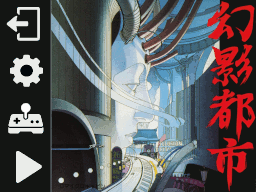
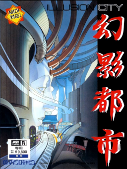

# Illusions-DS - MSX Illusion City Emulator

This Emulator is specifically for the amazing MSX-Translation of Illusion City.
Requires a DSi/XL/LL and will NOT run in DS-Lite or 'Compatibility' mode. The game
will check to make sure you have the needed processing power and RAM to run the game.

Besides Illusions-DS.nds, the only other file needed is the 4MB ASCII16-X ROM of Illusion City as produced by MSX Translations.

Place this file exactly named "Illusion City.rom" in the /roms folder on your SD card.

If you launch the emulator and get no warning screens, you will be greated with the main menu as such:

Assuming you have nothing to configure, just press the PLAY icon.

# Donations Welcome (but never required!)

These hobby emulators have been a labor of love. An embarassing amount of development time has gone into it as I've strived to provide an enjoyable retro experience on the DS handheld. It's free to use and always will be, however if you feel inclined to buy me a virtual coffee for the effort, that would be beyond amazing!

Copyright :
-----------------------
Illusions-DS is Copyright (c) 2026 Dave Bernazzani (wavemotion-dave)

As long as there is no commercial use (i.e. no profit is made),
copying and distribution of this emulator, it's source code
and associated readme files, with or without modification, 
are permitted in any medium without royalty provided this 
copyright notice is used and wavemotion-dave (Illusions-DS),
and Marat Fayzullin (fMSX core) are thanked profusely.

The sound driver (ay38910) are libraries from FluBBa (Fredrik Ahlström) 
and those copyrights remain his.

lzav compression (for save states) is Copyright (c) 2023-2025 Aleksey 
Vaneev and used by permission of the generous MIT license.

The Illusions-DS emulator is offered as-is, without any warranty.

Special thanks to the MSX Translation team for their amazing work!

Saving Progress :
-----------------------
Illusions-DS provides two ways to save your progress as you play. 
The first is via FM-PAC which is a standard MSX cart that provides
SRAM. This SRAM is preserved to your SD card so you can pick up 
where you left off. When playing Illusion City, you can load a game 
at any time but you can only save to SRAM when you are at a terminal
(such as the one in your starting room when the game begins). 

The other way to save is using one of the two built-in Save Slots.
Press the MSX key in the lower right to access the icon menu system
and you can save or restore directly to one of two save slots. These
can be used anytime.

Please note that flash-saves and disk saves are not supported at this time.

Version History :
-----------------------

Version 1.0 - 29-Oct-2026 by wavemotion-dave
* First major version released.

